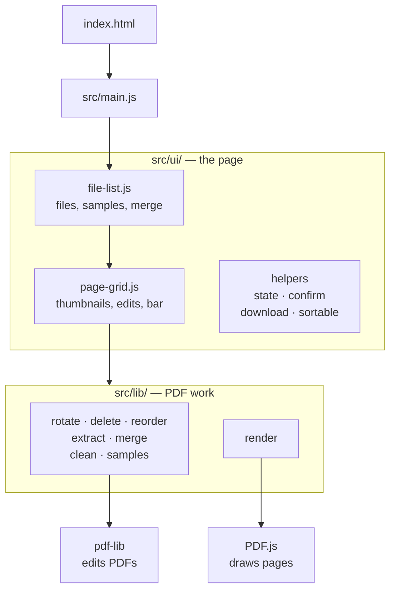

# Architecture

How the code fits together. For why, see the Decisions log in [PLAN.md](PLAN.md).

## Overview

Everything runs in the browser. GitHub Pages serves the built files, and PDFs never leave the device.



Both UI files call `src/lib/`, whose functions take bytes and return bytes, so each can be unit tested without the page.

## Files

| Path                                                                     | Job                                                                                         |
| ------------------------------------------------------------------------ | ------------------------------------------------------------------------------------------- |
| `index.html`                                                             | Page structure                                                                              |
| `src/style.css`                                                          | Styling, including phones (`40rem`), the bottom bar (`54rem`) and touch (`pointer: coarse`) |
| `src/main.js`                                                            | Loads the styles and the UI                                                                 |
| `src/lib/rotate.js`, `delete.js`, `reorder.js`, `extract.js`, `merge.js` | One PDF operation each                                                                      |
| `src/lib/clean.js`                                                       | `saveWithout`: saves a file with removed pages really gone                                  |
| `src/lib/validate.js`                                                    | Loading a PDF and checking page numbers                                                     |
| `src/lib/render.js`                                                      | Drawing thumbnails with PDF.js                                                              |
| `src/lib/samples.js`                                                     | Making the sample files                                                                     |
| `src/ui/file-list.js`                                                    | Adding files, samples, the file list, Merge                                                 |
| `src/ui/page-grid.js`                                                    | Thumbnails, selection, the bottom bar, edits, the page lock                                 |
| `src/ui/state.js`                                                        | Data shared by the UI files                                                                 |
| `src/ui/confirm.js`                                                      | The confirmation dialog                                                                     |
| `src/ui/download.js`                                                     | File checks, download names, saving files                                                   |
| `src/ui/sortable.js`                                                     | Shared drag settings                                                                        |
| `csp.js`, `vite.config.js`                                               | The Content-Security-Policy                                                                 |
| `scripts/copy-pdfjs-assets.js`                                           | Copies PDF.js's extra files into the site                                                   |
| `.github/workflows/ci.yml`                                               | Checks on every push; deploys from `main`                                                   |

## Shared data

```js
state.files; // the PDFs in the list, in order
state.previewedFile; // the one whose pages are shown
```

Each file is `{ name, bytes, originalBytes }`. Edits replace `bytes` with a new array, so `bytes !== originalBytes` means the file is edited, and Reset goes back to `originalBytes`.

`file-list.js` imports `page-grid.js`. For the grid to redraw the list without a circular import, the list passes it a function (`setFileListRedraw`).

## What happens when…

**A file is added:** `addFiles` checks the type and size, reads the bytes, adds the file to `state.files`, and calls `renderFileList`, which calls `renderPageGrid`.

**Pages are drawn:** `renderPageGrid` opens the file with PDF.js, adds a blank thumbnail of the right size for every page, then draws each one. If the user switches file, `latestRender` tells the old drawing to stop. Edits wait until drawing finishes.

**A page is edited:** `editPreviewedFile` locks the page with `runLocked` (everything but the bottom bar becomes `inert`), runs the `src/lib/` function, and updates the grid in place. Then it unlocks and restores focus. Merge uses the same lock.

**Pages are deleted or extracted:** `saveWithout` detaches anything pointing at removed pages, then deletes everything no longer reachable. If a removed page is still reachable, it copies the kept pages into a new file instead.

**A confirmation is needed:** `confirmAction(question, label)` opens the dialog and returns a promise of `true` or `false`.

## Tests

Unit tests sit beside the code (`*.test.js`) and run with `npm test`. See [TESTING.md](TESTING.md).
